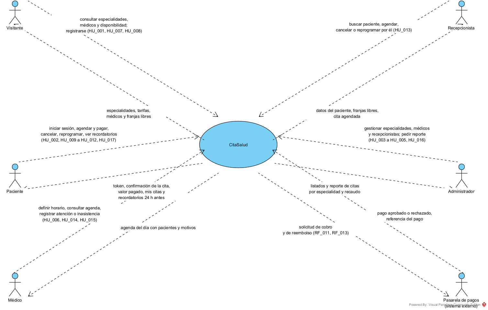
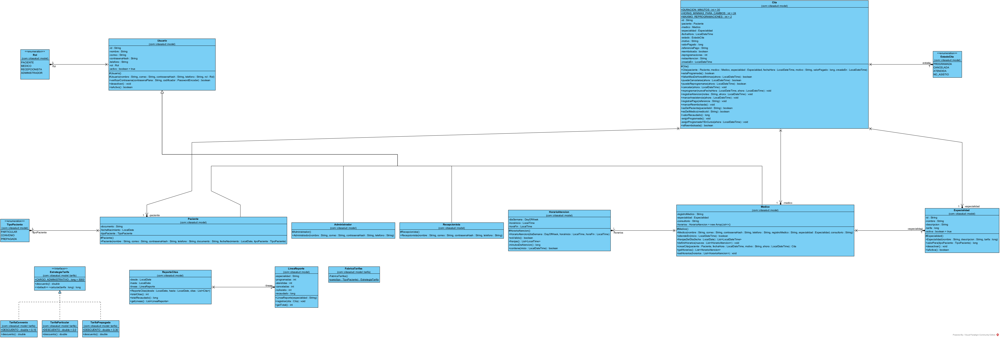
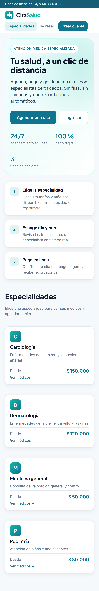
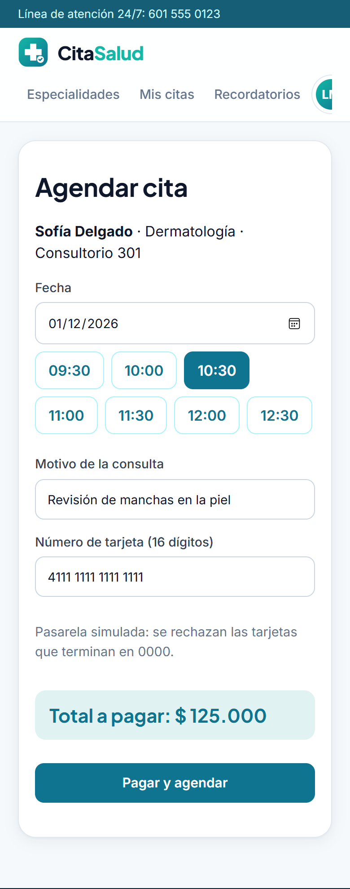
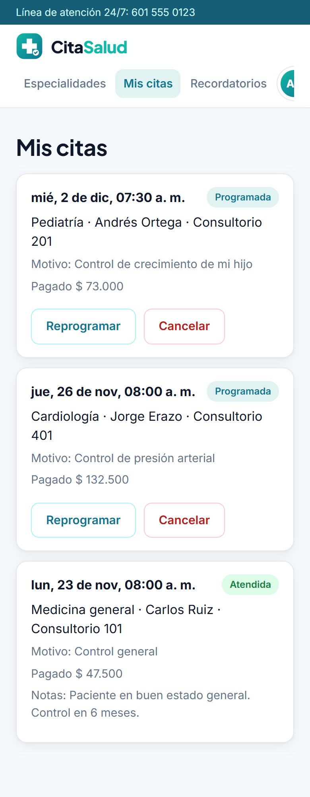
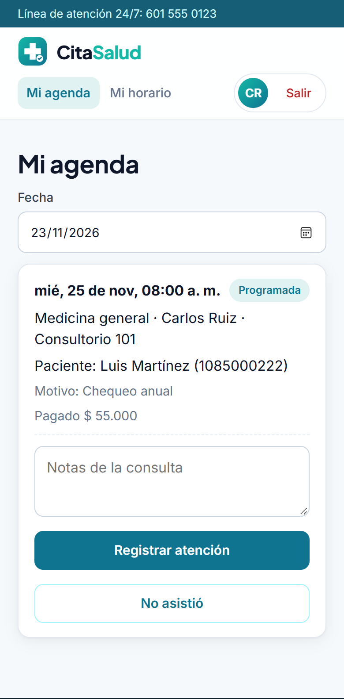

# CitaSalud

Plataforma web y móvil para agendar y gestionar citas médicas. Los pacientes consultan especialidades, médicos y horarios libres, agendan y pagan su cita, la pueden cancelar o reprogramar, y reciben un recordatorio un día antes. Los médicos definen su horario, ven su agenda y registran la atención. La recepción agenda por los pacientes que llaman o llegan, y el administrador gestiona la clínica y consulta reportes.

Proyecto final del curso **Diseño de Software**.

## Funcionalidades

| Épica | Historias |
|---|---|
| 1. Cuenta | HU_001 Registrarse como paciente · HU_002 Iniciar sesión |
| 2. Administración | HU_003 Especialidades · HU_004 Médicos · HU_005 Recepcionistas · HU_006 Horario de atención |
| 3. Consulta | HU_007 Especialidades y médicos · HU_008 Disponibilidad |
| 4. Citas | HU_009 Agendar · HU_010 Mis citas · HU_011 Cancelar · HU_012 Reprogramar · HU_013 Agendar por un paciente · HU_017 Recordatorios |
| 5. Atención y reportes | HU_014 Agenda del día · HU_015 Registrar atención · HU_016 Reporte de citas |

Detalle: [docs/historias](docs/historias/00-resumen.md) (17 HU, 46 puntos) y [docs/02-requisitos.md](docs/02-requisitos.md) (RF_001 a RF_019, RNF_001 a RNF_012).

### Reglas de negocio principales

- **Valor de la cita** = tarifa de la especialidad − descuento por tipo de paciente + cargo administrativo de $5.000.
- **Descuentos:** Particular 0 %, Convenio 15 %, Prepagada 30 %. Con tarifa de $60.000: $65.000, $56.000 y $47.000.
- Citas de **30 minutos**, solo dentro del horario del médico y en una franja libre.
- Un paciente no puede tener dos citas a la misma hora ni dos programadas en la misma especialidad.
- Cancelar o reprogramar solo con **más de 24 horas** de anticipación; máximo **2 reprogramaciones**.
- La cita solo queda programada si la **pasarela aprueba el pago**; al cancelar se pide el reembolso.
- Cada cita programada recibe un **recordatorio** cuando faltan 24 horas o menos (una tarea programada revisa cada 15 minutos).

## Tecnologías

| Parte | Tecnología |
|---|---|
| Backend | Java 17, Spring Boot 3.3.5 (Web, Data MongoDB, Security, Validation), JWT (jjwt 0.12.6), BCrypt, Swagger (springdoc 2.6.0) |
| Base de datos | MongoDB 7 |
| Pruebas | JUnit 5 + Mockito (30 pruebas) y Postman/Newman (61 peticiones, 87 validaciones) |
| Frontend | React 18 + Vite, diseño adaptable para celular |
| Infraestructura | Docker, docker-compose, GitHub Actions, Render, Vercel, MongoDB Atlas |

## Arquitectura

Arquitectura en capas con DTO: **Controller → Service → Repository → Model**. Los controllers nunca usan repositorios.

```
backend/src/main/java/com/citasalud/
├── controller/     Endpoints REST (9 controllers)
├── service/        Lógica y reglas de negocio (9 servicios)
├── repository/     Interfaces Spring Data MongoDB (4)
├── model/          Dominio: Usuario (abstracta) y sus hijas, Especialidad, Cita, Recordatorio, HorarioAtencion, ReporteCitas, enums
│   └── tarifa/     EstrategiaTarifa, FabricaTarifas y 3 tarifas (patrón Strategy)
├── integracion/    PasarelaPagos y NotificadorRecordatorios (interfaces) con sus versiones simuladas
├── dto/            *Request / *Response
├── security/       JWT (FiltroJwt, JwtServicio, UsuarioActual)
├── exception/      Excepciones y ManejadorErrores
└── config/         SecurityConfig, OpenApiConfig, RelojConfig, DatosIniciales
```

Diagramas hechos en Visual Paradigm (modelo [`diagramas/CitaSalud.vpp`](diagramas/CitaSalud.vpp), imágenes en [`diagramas/visual-paradigm/`](diagramas/visual-paradigm/)); trazabilidad y patrones GRASP/GoF en [diagramas/README.md](diagramas/README.md).

| Contexto | Lógica |
|---|---|
|  |  |

## Estructura del repositorio

```
├── backend/          API REST (Spring Boot)
├── frontend/         App React
├── database/         Colecciones de MongoDB
├── diagramas/        CitaSalud.vpp (Visual Paradigm), PNG exportados, borradores PlantUML y trazabilidad
├── docs/
│   ├── historias/    Una HU por archivo + resumen
│   ├── mockups/      Una pantalla por HU
│   ├── capturas/     Capturas de la app
│   ├── 02-requisitos.md
│   ├── guia-visual-paradigm.md
│   └── guia-exposicion.md
├── postman/          Colección y entornos
├── wiki/             Páginas de la wiki del repositorio
├── docker-compose.yml
└── render.yaml
```

## Cómo ejecutar

**Opción 1, con Docker** (no necesita Java ni MongoDB instalados):

```bash
docker compose up --build        # MongoDB + backend en http://localhost:8080
```

**Opción 2, sin Docker** (Java 17, Maven y MongoDB en `localhost:27017`):

```bash
cd backend
mvn spring-boot:run              # API en http://localhost:8080
mvn test                         # pruebas JUnit
```

**Frontend:**

```bash
cd frontend
cp .env.example .env
npm install
npm run dev                      # app en http://localhost:5173
```

- Swagger: http://localhost:8080/swagger-ui.html
- Estado: http://localhost:8080/api/estado

### Variables de entorno

| Variable | Para qué | Valor local por defecto |
|---|---|---|
| `MONGODB_URI` | Conexión a MongoDB | `mongodb://localhost:27017/citasalud` |
| `JWT_SECRET` | Clave para firmar tokens (mínimo 32 caracteres) | Una clave solo para desarrollo |
| `CORS_ORIGENES` | URL del frontend | `http://localhost:5173` |
| `DATOS_PRUEBA` | Cargar datos de prueba si la base está vacía | `true` |
| `RECORDATORIOS_INTERVALO_MS` | Cada cuánto se revisan las citas para crear recordatorios | `900000` (15 minutos) |

Las credenciales reales **nunca** se suben al repositorio (ver `backend/.env.example`).

## Cuentas de prueba

| Rol | Correo | Contraseña |
|---|---|---|
| Administrador | admin@citasalud.com | Admin123* |
| Recepcionista | recepcion@citasalud.com | Recepcion123* |
| Médico (Medicina general) | carlos.ruiz@citasalud.com | Medico123* |
| Médico (Pediatría) | andres.ortega@citasalud.com | Medico123* |
| Médico (Dermatología) | sofia.delgado@citasalud.com | Medico123* |
| Paciente (Convenio, tiene una cita mañana con recordatorio) | ana.perez@correo.com | Paciente123* |
| Paciente (Particular) | luis.martinez@correo.com | Paciente123* |
| Paciente (Prepagada) | camila.rosero@correo.com | Paciente123* |

Pasarela simulada: se aprueba cualquier tarjeta de 16 dígitos, salvo las que terminan en `0000`.

## Endpoints REST

| Método | Ruta | Rol | HU |
|---|---|---|---|
| POST | `/api/auth/registro` | Público | HU_001 |
| POST | `/api/auth/login` | Público | HU_002 |
| GET | `/api/auth/yo` | Con sesión | HU_002 |
| GET | `/api/especialidades` | Público | HU_007 |
| GET | `/api/especialidades/{id}/valor?tipoPaciente=` | Público | HU_009 (RF_010) |
| POST / PUT / DELETE | `/api/especialidades[/{id}]` | Administrador | HU_003 |
| GET | `/api/medicos?especialidadId=` | Público | HU_007 |
| GET | `/api/medicos/{id}/disponibilidad?fecha=` | Público | HU_008 |
| POST / PUT / DELETE | `/api/medicos[/{id}]` | Administrador | HU_004 |
| PUT | `/api/medicos/{id}/horarios` | Médico (el suyo) o Administrador | HU_006 |
| GET / POST / DELETE | `/api/recepcionistas[/{id}]` | Administrador | HU_005 |
| GET | `/api/pacientes?documento=` | Recepcionista, Administrador | HU_013 |
| POST | `/api/citas` | Paciente, Recepcionista | HU_009, HU_013 |
| GET | `/api/citas/mias` | Paciente | HU_010 |
| GET | `/api/citas/{id}` | Dueño de la cita, Recepcionista, Administrador | HU_010 |
| PUT | `/api/citas/{id}/cancelar` | Paciente (la suya), Recepcionista | HU_011 |
| PUT | `/api/citas/{id}/reprogramar` | Paciente (la suya), Recepcionista | HU_012 |
| GET | `/api/citas/agenda?fecha=` | Médico | HU_014 |
| PUT | `/api/citas/{id}/atencion` · `/inasistencia` | Médico de la cita | HU_015 |
| GET | `/api/reportes/citas?desde=&hasta=` | Administrador | HU_016 |
| GET | `/api/recordatorios/mios` | Paciente | HU_017 |
| PUT | `/api/recordatorios/{id}/leido` | Paciente (el suyo) | HU_017 |
| POST | `/api/recordatorios/generar` | Recepcionista, Administrador | HU_017 |

Errores con mensaje en español: 400 (datos inválidos), 401 (sin sesión), 402 (pago rechazado), 403 (sin permiso), 404 (no existe), 409 (conflicto: correo repetido, franja ocupada), 422 (regla de negocio).

## Pruebas

```bash
cd backend && mvn test           # 30 pruebas JUnit
newman run postman/CitaSalud.postman_collection.json -e postman/CitaSalud-Local.postman_environment.json
```

La colección está organizada por historia de usuario. Se ejecuta en orden con el *Runner* de Postman. GitHub Actions corre ambas en cada push (`.github/workflows/ci.yml`).

## Despliegue en la nube

1. **MongoDB Atlas:** crear un cluster M0 gratis y copiar la cadena de conexión.
2. **Render:** *New → Blueprint* con este repositorio (usa `render.yaml`). Poner `MONGODB_URI` y `CORS_ORIGENES` (URL de Vercel) en el panel.
3. **Vercel:** importar el repositorio, carpeta raíz `frontend`, variable `VITE_API_URL` con la URL de Render.
4. Cambiar la URL del entorno `postman/CitaSalud-Nube.postman_environment.json`.

## Capturas

| Especialidades | Agendar | Mis citas | Agenda del médico |
|---|---|---|---|
|  |  |  |  |
