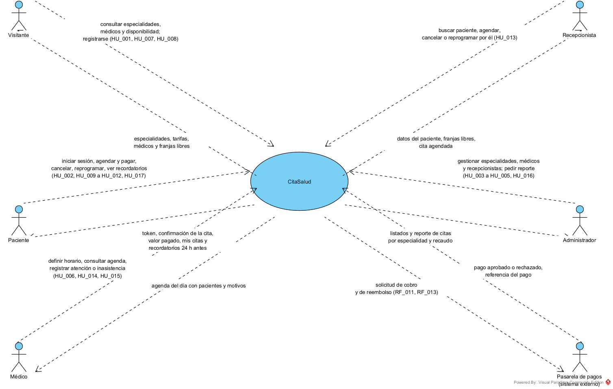
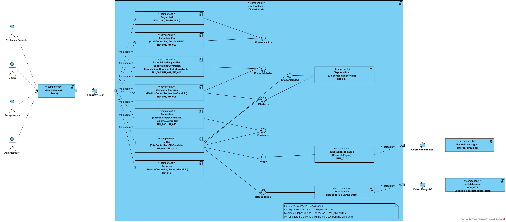
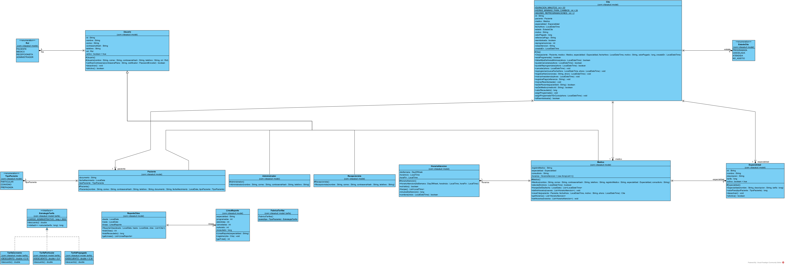
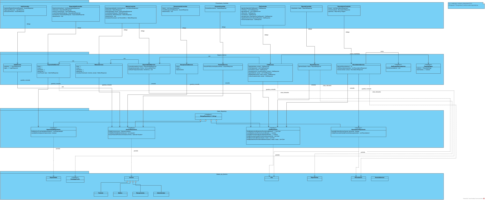
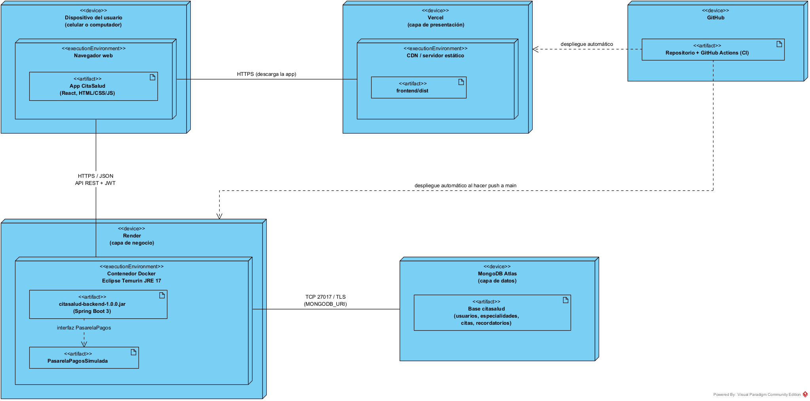
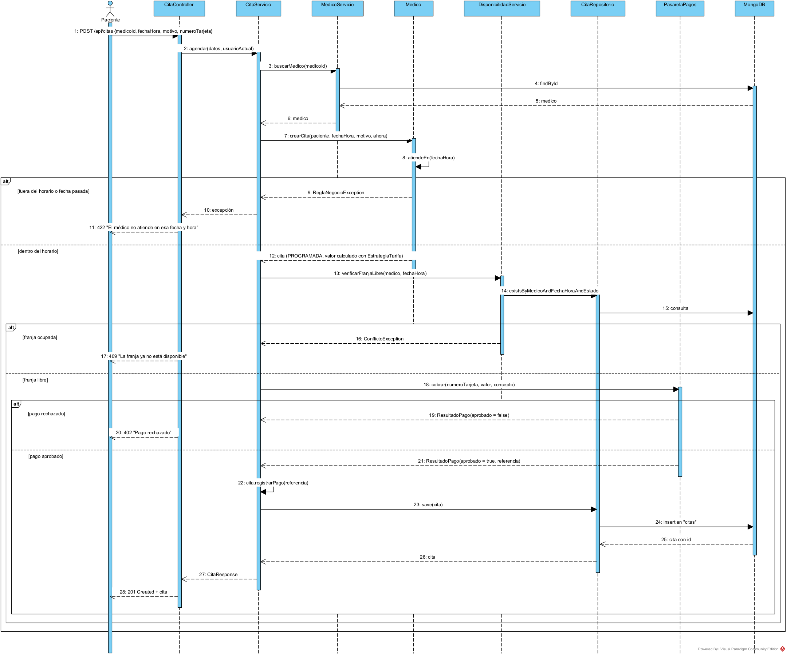
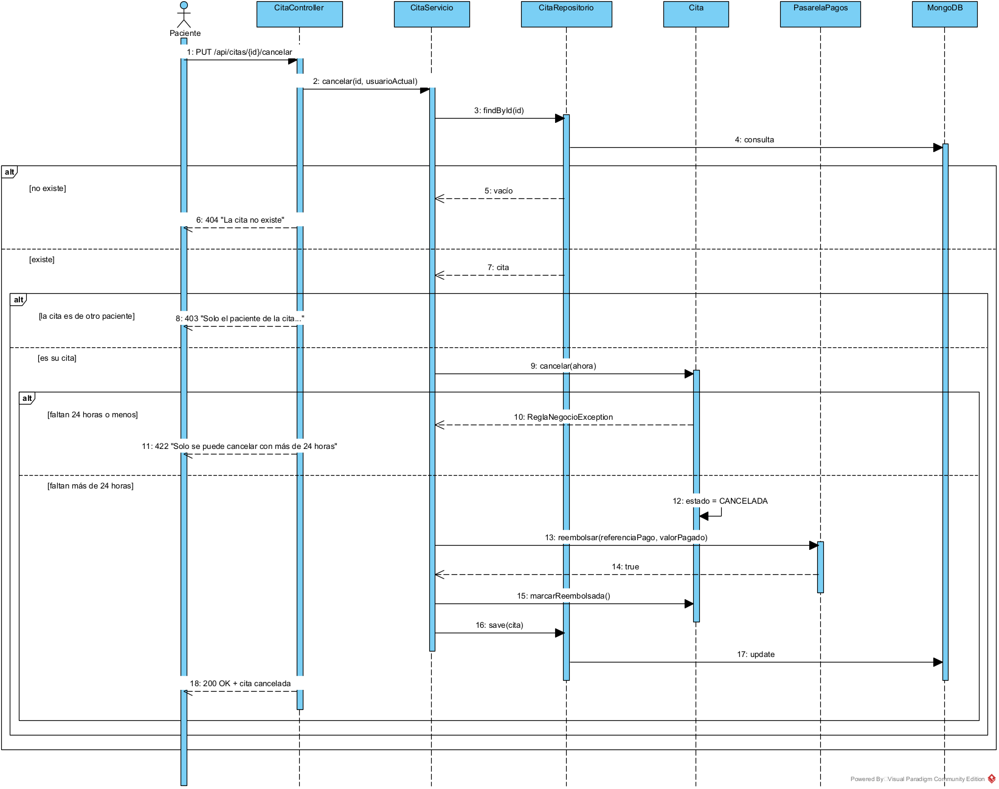

# Diagramas UML de CitaSalud

Los diagramas finales están hechos en **Visual Paradigm Community 18.1**. El modelo fuente es [`diagramas/CitaSalud.vpp`](CitaSalud.vpp) (un proyecto con los 7 diagramas) y las imágenes exportadas están en [`diagramas/visual-paradigm/`](visual-paradigm/).

Los archivos `diagramas/vista-*.png`, `diagramas/secuencia-*.png` y `diagramas/fuentes/*.puml` son los **borradores en PlantUML** que sirvieron de plano; se conservan solo como referencia.

| Vista | Visual Paradigm | Borrador PlantUML | Tipo de diagrama | Qué cubre |
|---|---|---|---|---|
| 1. Contexto (nivel 0) | [`vp-contexto.png`](visual-paradigm/vp-contexto.png) | [`vista-contexto.png`](vista-contexto.png) | Diagrama de contexto: el sistema como un círculo y 6 actores; flechas de acciones hacia el sistema y de datos desde el sistema | Todas las HU |
| 2. Funcional | [`vp-funcional.png`](visual-paradigm/vp-funcional.png) | [`vista-funcional.png`](vista-funcional.png) | Diagrama de componentes con puertos, interfaces provistas y requeridas y «delegate» | Componentes ↔ HU (tabla abajo) |
| 3. Lógica | [`vp-logica.png`](visual-paradigm/vp-logica.png) | [`vista-logica.png`](vista-logica.png) | Diagrama de clases del dominio con herencia, interfaces, enumeraciones y multiplicidades | Paquete `model` |
| 4. Desarrollo | [`vp-desarrollo.png`](visual-paradigm/vp-desarrollo.png) | [`vista-desarrollo.png`](vista-desarrollo.png) | Clases por capas: `Presentacion_Controller`, `Negocio_Service`, `Datos_Repository` y `Modelo_de_Dominio` | Paquetes `controller`, `service`, `repository`, `model` |
| 5. Despliegue | [`vp-despliegue.png`](visual-paradigm/vp-despliegue.png) | [`vista-despliegue.png`](vista-despliegue.png) | Nodos en tres capas: dispositivo/navegador, Vercel, Render (Docker) y MongoDB Atlas, más GitHub | RNF_009 |
| Secuencia: agendar cita | [`vp-secuencia-agendar-cita.png`](visual-paradigm/vp-secuencia-agendar-cita.png) | [`secuencia-agendar-cita.png`](secuencia-agendar-cita.png) | HU_009 con fragmentos alt: fuera de horario (422), franja ocupada (409), pago rechazado (402), éxito (201) | RF_009 a RF_011 |
| Secuencia: cancelar cita | [`vp-secuencia-cancelar-cita.png`](visual-paradigm/vp-secuencia-cancelar-cita.png) | [`secuencia-cancelar-cita.png`](secuencia-cancelar-cita.png) | HU_011 con fragmentos alt: no existe (404), otra persona (403), menos de 24 h (422), éxito (200) | RF_013 |

## Trazabilidad de la vista funcional

| Componente | Clases del código | HU | RF |
|---|---|---|---|
| Autenticación | `AuthController`, `AuthServicio` | HU_001, HU_002 | RF_001, RF_002 |
| Seguridad | `FiltroJwt`, `JwtServicio`, `SecurityConfig` | Todas las que requieren sesión | RNF_004 |
| Especialidades y tarifas | `EspecialidadController`, `EspecialidadServicio`, `model/tarifa` | HU_003, HU_007 | RF_003, RF_007, RF_010 |
| Médicos y horarios | `MedicoController`, `MedicoServicio` | HU_004, HU_006 | RF_004, RF_006 |
| Disponibilidad | `DisponibilidadServicio` | HU_008 | RF_008 |
| Recepción | `RecepcionistaController`, `PacienteController` y sus servicios | HU_005, HU_013 | RF_005, RF_015 |
| Citas | `CitaController`, `CitaServicio` | HU_009 a HU_015 | RF_009 a RF_017 |
| Reportes | `ReporteController`, `ReporteServicio` | HU_016 | RF_018 |
| Integración de pagos | `PasarelaPagos`, `PasarelaPagosSimulada` | HU_009, HU_011 | RF_011, RF_013, RNF_012 |
| Recordatorios | `RecordatorioController`, `RecordatorioServicio`, `NotificadorRecordatorios` | HU_017 | RF_019, RNF_012 |
| Persistencia | `UsuarioRepositorio`, `EspecialidadRepositorio`, `CitaRepositorio` | Todas | RNF_002 |

## Patrones de diseño

**GRASP**
- **Controlador:** cada `*Controller` recibe la petición HTTP y delega en su servicio, sin reglas de negocio.
- **Experto en información:** `Usuario.verificarContrasena`, `Especialidad.valorPara`, `Medico.atiendeEn`, `HorarioAtencion.franjas`, `Cita.puedeCancelarse` / `cancelar` / `reprogramar` / `necesitaRecordatorio`, `Recordatorio.estaVigente`.
- **Creador:** `Medico.crearCita()` crea la `Cita` (el médico tiene la agenda); `ReporteCitas` crea sus `LineaReporte`.
- **Polimorfismo:** `EstrategiaTarifa` con `TarifaParticular`, `TarifaConvenio`, `TarifaPrepagada`.
- **Fabricación pura:** `FabricaTarifas`, los repositorios y `DisponibilidadServicio`.
- **Indirección / Variaciones protegidas:** `PasarelaPagos` (cambiar de pasarela no toca `CitaServicio`), `NotificadorRecordatorios` (cambiar de correo a SMS no toca `RecordatorioServicio`) y `EstrategiaTarifa`.
- **Bajo acoplamiento y alta cohesión:** capas separadas con DTO e inyección por constructor.

**GoF y otros**
- **Strategy:** las tarifas. **Simple Factory:** `FabricaTarifas.para()`.
- **Repository:** interfaces de Spring Data. **DTO:** `dto/*Request` y `*Response`.
- **Chain of Responsibility:** `FiltroJwt` dentro de la cadena de filtros de Spring Security.
- **Inyección de dependencias:** servicios, repositorios, `PasarelaPagos`, `NotificadorRecordatorios` y el `Clock` de `RelojConfig`.
- **Manejador global de errores:** `ManejadorErrores` (`@RestControllerAdvice`).

## Cómo abrir y exportar el modelo

Ver [`docs/guia-visual-paradigm.md`](../docs/guia-visual-paradigm.md).

Para regenerar los borradores PlantUML: `java -jar plantuml.jar -tpng -o .. fuentes/*.puml` (requiere Graphviz).

## Diagramas (Visual Paradigm)

### 1. Contexto (nivel 0)

### 2. Funcional

### 3. Lógica

### 4. Desarrollo

### 5. Despliegue

### Secuencia: agendar cita

### Secuencia: cancelar cita

