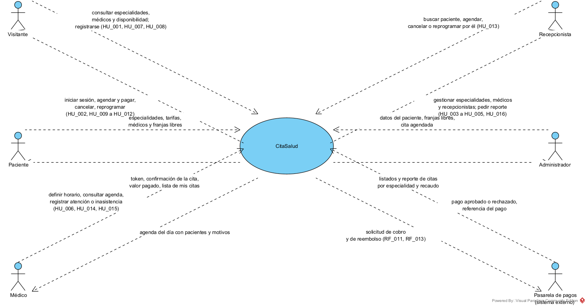

# 2. Descripción general

## Actores
| Actor | Tipo | Qué hace |
|---|---|---|
| Visitante | Persona sin cuenta | Consulta especialidades, médicos y disponibilidad; se registra |
| Paciente | Usuario registrado | Agenda y paga, consulta, cancela y reprograma sus citas |
| Médico | Usuario registrado | Define su horario, consulta su agenda, registra atención o inasistencia |
| Recepcionista | Usuario registrado | Busca pacientes y agenda, cancela o reprograma por ellos |
| Administrador | Usuario registrado | Gestiona especialidades, médicos y recepcionistas; consulta reportes |
| Pasarela de pagos | Sistema externo | Aprueba o rechaza cobros y procesa reembolsos (simulada) |

Paciente, Médico, Recepcionista y Administrador heredan de la clase abstracta `Usuario`.

## Restricciones
- Backend en Java 17 con Spring Boot 3 y base de datos MongoDB.
- Diagramas en Visual Paradigm (modelo `diagramas/CitaSalud.vpp`).
- Ninguna credencial dentro del repositorio.

