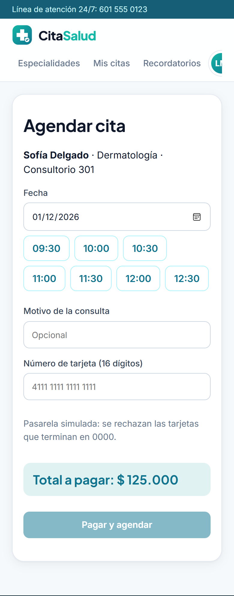

# HU_008: Consultar disponibilidad de un médico

| Campo | Valor |
|---|---|
| Épica | 3. Consulta |
| Actor | Visitante, Paciente, Recepcionista |
| Prioridad | Alta |
| Puntos de historia | 3 |
| Requisitos | RF_008 |
| Reglas de negocio | RN_04, RN_05 |
| Mockup |  |

## Historia

**Como** paciente,  
**quiero** ver las franjas libres de un médico en una fecha,  
**para** escoger la hora de mi cita.

## Validación INVEST

| Criterio | Cumple | Justificación |
|---|---|---|
| Independiente | Sí | Se puede desarrollar y probar sin esperar otras historias, salvo los datos que crea el administrador. |
| Negociable | Sí | Los detalles de pantalla y mensajes se pueden ajustar con el profesor. |
| Valiosa | Sí | Le da valor directo al visitante: escoger la hora de mi cita. |
| Estimable | Sí | Alcance claro; estimada en 3 puntos. |
| Pequeña | Sí | Cabe en un sprint de una semana. |
| Testeable | Sí | Tiene criterios de aceptación verificables con pruebas y Postman. |

## Criterios de aceptación

```gherkin
# language: es
Característica: Consultar disponibilidad de un médico

  Escenario: Franjas libres
    Dado que el médico atiende los lunes de 08:00 a 10:00
    Y ya tiene una cita programada el lunes a las 08:30
    Cuando consulto su disponibilidad para ese lunes
    Entonces veo libres las franjas 08:00, 09:00 y 09:30

  Escenario: Día sin atención
    Dado que el médico no atiende los domingos
    Cuando consulto un domingo
    Entonces veo que no hay franjas disponibles

  Escenario: Fecha pasada
    Dado que hoy es 22 de noviembre
    Cuando consulto la disponibilidad del 20 de noviembre
    Entonces no veo franjas disponibles

```

## Reglas de negocio relacionadas

- **RN_04.** Las citas duran 30 minutos y solo se agendan dentro del horario de atención del médico, en fechas futuras.
- **RN_05.** Un médico no puede tener dos citas programadas en la misma franja.

## Supuestos

- Las franjas ya pasadas del día de hoy no se muestran.
