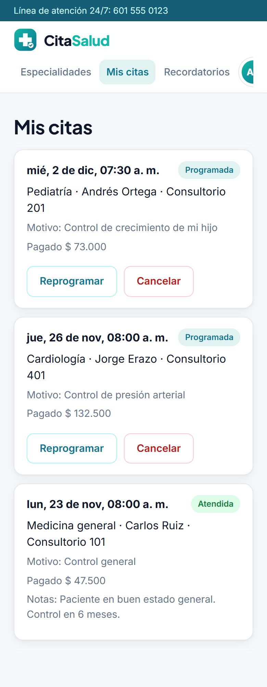

# HU_010: Consultar mis citas

| Campo | Valor |
|---|---|
| Épica | 4. Citas |
| Actor | Paciente |
| Prioridad | Media |
| Puntos de historia | 2 |
| Requisitos | RF_012 |
| Reglas de negocio | RN_07 |
| Mockup |  |

## Historia

**Como** paciente,  
**quiero** ver mis citas con su estado, médico, fecha y valor pagado,  
**para** recordar cuándo tengo que ir y llevar control de mis consultas.

## Validación INVEST

| Criterio | Cumple | Justificación |
|---|---|---|
| Independiente | Sí | Se puede desarrollar y probar sin esperar otras historias, salvo los datos que crea el administrador. |
| Negociable | Sí | Los detalles de pantalla y mensajes se pueden ajustar con el profesor. |
| Valiosa | Sí | Le da valor directo al paciente: recordar cuándo tengo que ir y llevar control de mis consultas. |
| Estimable | Sí | Alcance claro; estimada en 2 puntos. |
| Pequeña | Sí | Cabe en un sprint de una semana. |
| Testeable | Sí | Tiene criterios de aceptación verificables con pruebas y Postman. |

## Criterios de aceptación

```gherkin
# language: es
Característica: Consultar mis citas

  Escenario: Ver mis citas
    Dado que tengo 3 citas registradas
    Cuando consulto mis citas
    Entonces veo las 3 ordenadas de la más reciente a la más antigua
    Y cada una muestra su estado

  Escenario: Sin citas
    Dado que no tengo citas
    Cuando consulto mis citas
    Entonces veo un mensaje que dice que aún no tengo citas

```

## Reglas de negocio relacionadas

- **RN_07.** Estados de la cita: Programada, Cancelada, Atendida, No asistió.

## Supuestos

- Un paciente solo ve sus propias citas.
