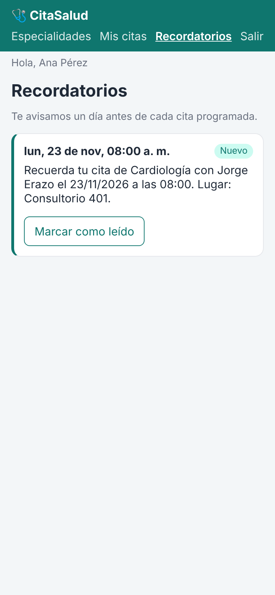

# HU_017: Recibir recordatorios de citas

| Campo | Valor |
|---|---|
| Épica | 4. Citas |
| Actor | Paciente |
| Prioridad | Media |
| Puntos de historia | 3 |
| Requisitos | RF_019 |
| Reglas de negocio | RN_07, RN_13 |
| Mockup |  |

## Historia

**Como** paciente,  
**quiero** recibir un recordatorio de mis citas un día antes,  
**para** no olvidarlas y llegar a tiempo al consultorio.

## Validación INVEST

| Criterio | Cumple | Justificación |
|---|---|---|
| Independiente | Sí | Solo necesita que existan citas programadas; se desarrolla y prueba aparte del agendamiento. |
| Negociable | Sí | El canal (pantalla, correo o SMS) y la anticipación se pueden ajustar con el profesor. |
| Valiosa | Sí | Le da valor directo al paciente y reduce las inasistencias para la clínica. |
| Estimable | Sí | Alcance claro; estimada en 3 puntos. |
| Pequeña | Sí | Cabe en un sprint de una semana. |
| Testeable | Sí | Tiene criterios de aceptación verificables con pruebas JUnit (reloj fijo) y Postman. |

## Criterios de aceptación

```gherkin
# language: es
Característica: Recibir recordatorios de citas

  Escenario: Recordatorio de una cita de mañana
    Dado que tengo una cita programada para dentro de 20 horas
    Cuando el sistema revisa las citas próximas
    Entonces se crea un recordatorio con la especialidad, el médico, la fecha, la hora y el consultorio
    Y lo veo en la sección "Recordatorios"

  Escenario: No se repite el recordatorio
    Dado que mi cita de mañana ya tiene un recordatorio
    Cuando el sistema vuelve a revisar las citas próximas
    Entonces no se crea otro recordatorio para la misma cita

  Escenario: Cita cancelada o reprogramada
    Dado que tenía un recordatorio de una cita
    Cuando la cita se cancela o se mueve a otra fecha
    Entonces ese recordatorio deja de mostrarse

  Escenario: Marcar como leído
    Dado que tengo un recordatorio nuevo
    Cuando lo marco como leído
    Entonces queda marcado como "Leído"
    Y otro paciente no puede modificarlo
```

## Reglas de negocio relacionadas

- **RN_07.** Estados de la cita: Programada, Cancelada, Atendida, No asistió.
- **RN_13.** Cada cita programada recibe un recordatorio cuando faltan 24 horas o menos; nunca se envía para citas canceladas ni se repite para la misma fecha.

## Supuestos

- El sistema revisa las citas próximas cada 15 minutos de forma automática (tarea programada). La recepcionista o el administrador pueden lanzar la revisión en el momento.
- En el proyecto el envío por correo o SMS está simulado (se escribe en el registro del servidor) detrás de la interfaz `NotificadorRecordatorios`; el paciente ve el recordatorio en la aplicación.
